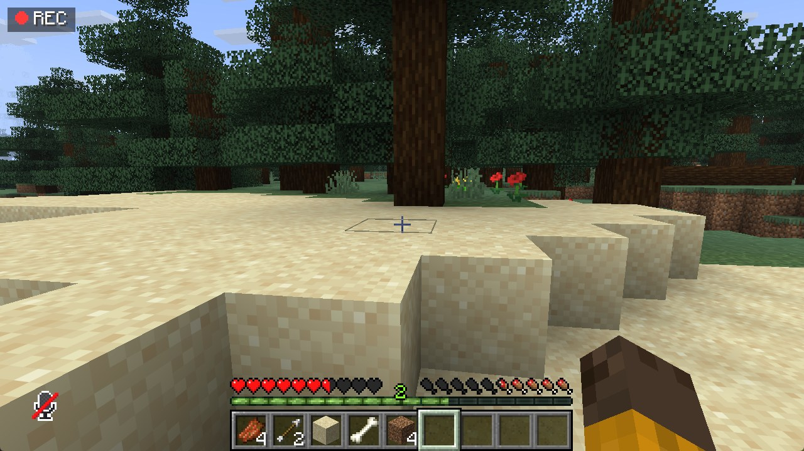
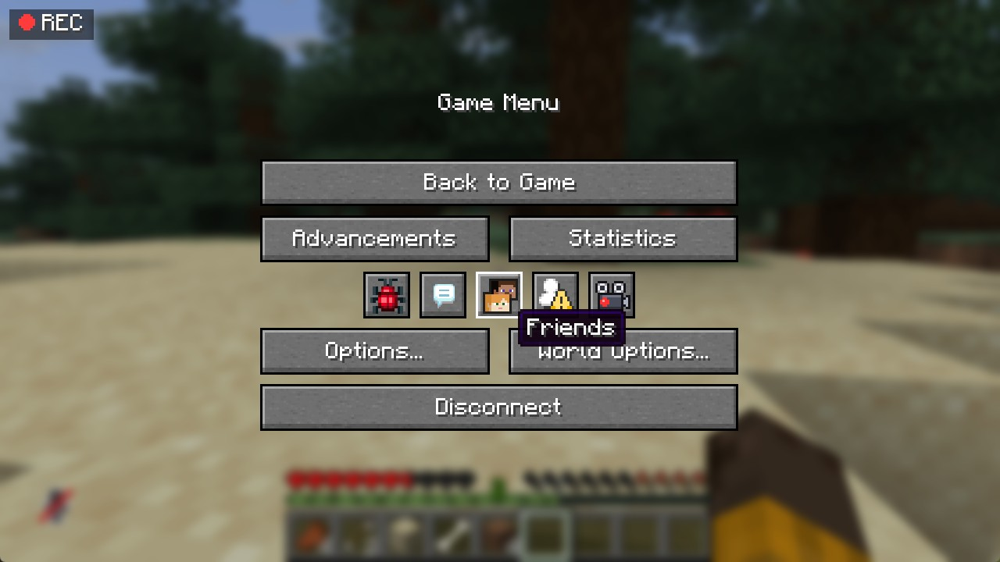
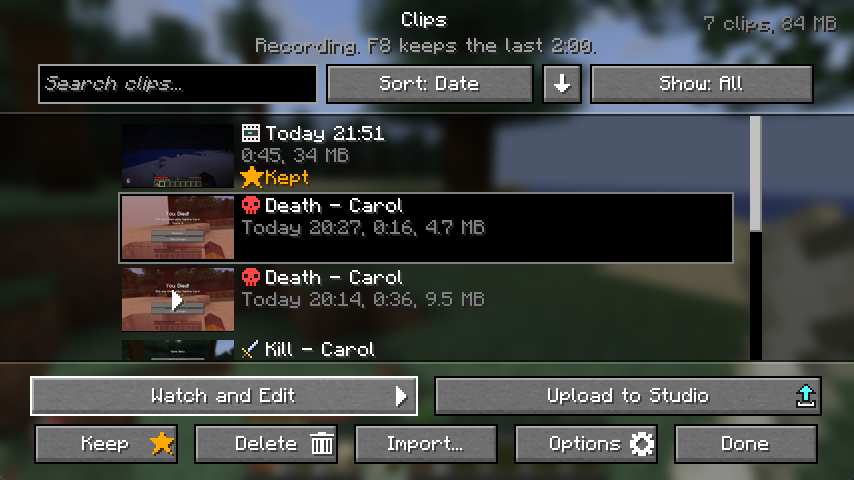
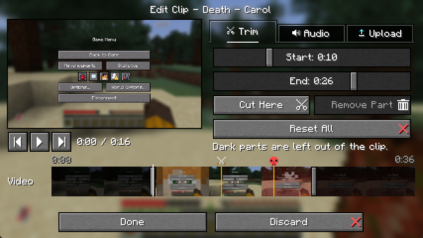
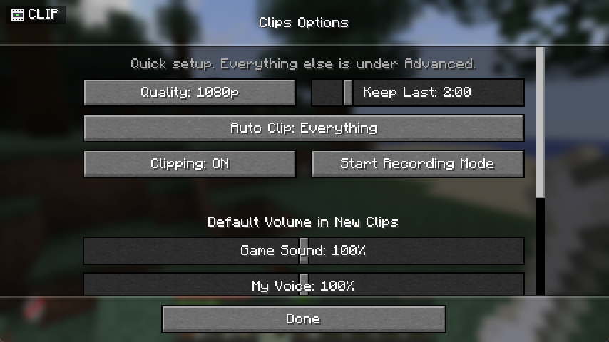
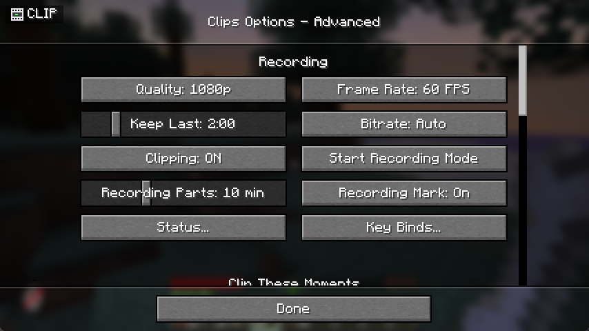

# OrderSMP Clips

Save your best Minecraft moments without thinking about it. OrderSMP Clips keeps the last few
minutes of your game ready, saves a video by itself when you win or lose a fight, and lets you trim
it and share it, all without leaving the game.



**[Download the latest version](https://github.com/Kalvisan/ordersmp-clips/releases)** ·
[Install](#install) · [How to use it](#how-to-use-it) · [Questions](#questions)

> OrderSMP Clips is in early access. It works well on Windows with an NVIDIA graphics card. Other
> setups should work too but are not tested yet, so please tell us how it goes.

## What you get

- **Clips that save themselves.** Win or lose a fight against another player and the clip is
  saved for you, from just before the first hit to just after the end.
- **The last minutes, always ready.** Press **F8** to save what just happened. Keep from 30
  seconds up to 10 minutes.
- **Record a whole session.** Turn on Recording mode to keep everything you play.
- **Edit in the game.** Trim the start and end, cut out the boring middle, and change the volume
  of each sound track.
- **Game sound and voice chat.** Every clip has the game's sound. With Simple Voice Chat, your
  voice and every player you hear get their own track.
- **Hardly any lag.** Your graphics card does the recording, so your game keeps its frame rate.
- **Works everywhere.** Singleplayer and any server. Your clips stay on your PC until you choose to
  share them.

## Install

You need Minecraft Java Edition 26.3 with Fabric.

1. **Get Fabric.** Install [Fabric Loader](https://fabricmc.net/use/installer/), or make a new
   Fabric instance in your launcher (CurseForge, Modrinth App, Prism Launcher or MultiMC). Add
   [Fabric API](https://modrinth.com/mod/fabric-api) to it.
2. **Add the mod.** Download `ordersmp-clips-<version>.jar` from the
   [Releases page](https://github.com/Kalvisan/ordersmp-clips/releases) and put it in your
   instance's `mods` folder.
3. **Install FFmpeg**, the free program that writes the video files:
   - **Windows:** open a terminal and run `winget install Gyan.FFmpeg`.
   - **macOS:** run `brew install ffmpeg`.
   - **Linux:** install the `ffmpeg` package, for example `sudo apt install ffmpeg`.

   Or put `ffmpeg.exe` in the `ordersmp-clips` folder inside your instance.
4. **Start the game** and join a world. When a red dot and `REC` show in the top left corner,
   you are ready.

## How to use it

### Keys

| Key | What it does |
|---|---|
| **F8** | Save the last minutes as a clip |
| **J** | Open your clips |
| **F6** | Start or stop Recording mode |
| **F9** | Pause or resume recording |

You can change the keys in **Options > Controls > Key Binds > OrderSMP Clips**.

### Your clips

Press **J**, or press **Esc** and click the camera icon in the game menu.



Every clip shows a picture, what happened (a sword for a kill, a skull for a death), how long it is
and whether it is already in Studio.



- **Search** by player name, type or date, for example `Raven` or `18 Nov`.
- **Sort** by date, length, size or type. The arrow next to it flips the order.
- **Show** only kills, deaths, fights, clips you saved, recordings, kept clips or clips in Studio.
- **Watch and Edit** (or a double click) opens the editor.
- **Keep** protects a clip from being cleaned up by the storage limits.
- **Import...** brings in MP4 videos from your PC. You can also drop them onto the game window.

### Edit a clip



- **Play** the clip with the buttons, or press **Space**. **Left** and **Right** jump one second.
- **Trim** with the Start and End sliders, or drag the handles on the timeline.
- **Markers** on the timeline show the first hit, each kill and your death.
- **Cut Here** and **Remove Part** take out a part in the middle. **Reset All** undoes everything.
- **Audio** has a volume slider and a mute button for each track.
- **Done** keeps your edits. The original video is never changed.
- **Save as New Clip** (Upload tab) makes a new video with only the parts you kept, in full
  quality.

### Share to OrderSMP Studio

**Upload to Studio** sends a clip, with your edits, to your
[OrderSMP Studio](https://studio.ordersmp.net) library, where you can add effects and captions and
post it.

- The first time, your browser opens Studio. Press **Approve** and the game carries on by itself.
- The button shows the progress and turns into **Open in Studio** when the upload is done.
- Nothing is posted anywhere until you post it yourself in Studio.

### Recording mode

Press **F6** to record everything you play. It saves in 10 minute parts, and each part shows up
in your clips as soon as it is finished. F8 still works while it records. Recording stops by itself
when your disk is almost full.

### The corner mark

The mark in the top left corner tells you what Clips is doing. You see it, but your clips never
show it.

| Mark | What it means |
|---|---|
| Red dot, `REC` | Ready. The last minutes can be saved |
| Crossed swords, `Fight 0:12` | A fight is going on and will become a clip |
| Sword, `Kill x1` | You got a kill. The clip saves when the fight ends |
| Red dot, `LIVE 12:34` | Recording mode is on |
| Grey ring, `Paused` | Recording is paused |
| Yellow, `Saving` | A clip is being saved |
| Yellow, `Clips off` | Something is missing. A message tells you what |

## Options

Open **Options** on the Clips screen. The first page has what most people change. **Advanced...**
has everything else.



- **Quality and Keep Last:** video quality and how much of the last play to keep ready.
- **Auto Clip:** which moments save themselves: kills, deaths, or long fights too.
- **Default volume:** game sound, your voice and other players in new clips.
- **Status...:** shows whether recording works and what it uses.



On the Advanced page you can also set the frame rate, how many seconds an automatic clip keeps
before the first hit and after the kill, whether kills close together make one clip, which voices
to keep, and storage limits that clean up old clips you did not keep. Nothing is cleaned up unless
you turn it on.

## Questions

**It says "Clips needs FFmpeg".**
FFmpeg is not installed, or Windows cannot find it. Install it as shown in [Install](#install) and
restart the game.

**It says "Clips cannot record".**
Update your graphics card driver. If it still does not work, open the settings file (see below)
and set `"encoder": "libx264"` to record without the graphics card.

**My clips stutter.**
Lower the frame rate to 30 FPS or the quality to 720p in Options.

**Where are my clips?**
In the `clips` folder of your instance. Each clip is a normal MP4 file you can open anywhere.

**Does it work on servers that do not have the mod?**
Yes. Clips runs only on your PC and works on any server and in singleplayer.

**Does changing a clip's volume change my game's volume?**
No. They are completely separate.

## Good to know

- Game sound is rebuilt from the sounds the game played, so it is very close to what you heard but
  not exact. Sound mods that add echo, and sounds other mods play on their own, are not included.
- Clips uses memory for the minutes it keeps ready: about 150 MB for 2 minutes and about 1 GB for
  10 minutes at 1080p.
- Tested on Windows with NVIDIA. AMD, Intel, macOS, Linux and shader packs are not tested yet.

## Coming next

- Sound in the editor preview
- Voices at the distance you heard them
- Exact fight times from the OrderSMP server
- A new version for each Minecraft release

## For developers

<details>
<summary>Settings file</summary>

Settings are saved in `<instance>/config/ordersmp-clips.json`. Everything in it can also be changed
in Options, except `encoder`, `ffmpegPath` and `studioUrl`.

| Setting | What it does |
|---|---|
| `bufferSeconds` | Seconds of play kept ready to save (10 to 600) |
| `fps` | Frame rate of clips (15 to 60) |
| `maxHeight` | Largest video height in pixels (360 to 2160) |
| `bitrateMbps` | Video bitrate in Mbps, `0` picks one for the quality |
| `encoder` | Force an FFmpeg encoder such as `h264_nvenc`, empty picks the best one |
| `ffmpegPath` | Full path to FFmpeg, empty looks in the mod folder and on `PATH` |
| `showHud`, `markMinimal` | Show the corner mark, and show only its icon |
| `studioUrl` | The OrderSMP Studio address that uploads go to |
| `sendToStudio` | Upload new automatic clips by themselves |
| `recordingPartMinutes` | Length of each Recording mode part (1 to 60 minutes) |
| `clipKills`, `clipDeaths`, `clipLongFights` | Which moments save themselves |
| `beforeSeconds`, `afterSeconds` | Seconds kept before the first hit and after the end (0 to 15) |
| `closeKillsOneClip` | Kills close together make one clip |
| `volumeGame`, `volumeMine`, `volumeOthers` | Default volumes in new clips, in percent |
| `recordMyVoice`, `recordOthers` | Keep your voice and the voices you hear |
| `maxSizeGb` | Largest size of the clips folder, `0` for no limit |
| `deleteAfterDays` | Days before clips not marked Kept are deleted, `0` to keep them |

</details>

<details>
<summary>Build from source</summary>

```bash
git clone https://github.com/Kalvisan/ordersmp-clips.git
cd ordersmp-clips
./gradlew build
```

The jar is written to `build/libs/`. `./gradlew runClient` starts a test client. You need JDK 25.

Pushing a tag such as `v0.2.0` builds the jar and publishes it on the Releases page. A tag with a
dash, such as `v0.2.0-alpha.1`, becomes a pre-release.

</details>

Bug reports and pull requests are welcome. See [CONTRIBUTING.md](CONTRIBUTING.md).

## License

[MIT](LICENSE). OrderSMP Clips runs FFmpeg as a separate program and does not include it. FFmpeg
has its own license. Minecraft is a trademark of Mojang Studios. This project is not affiliated
with Mojang or Microsoft.
